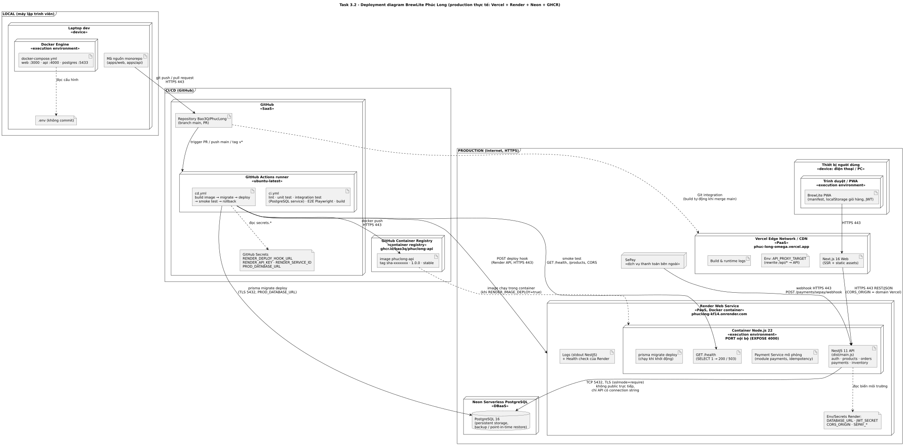

# Task 3.1 — Mô tả kiến trúc BrewLite

> Kiến trúc trình bày theo kiểu **C4 mức 2 (Container)** kết hợp mô tả phân lớp. Mỗi quyết định quan trọng được ghi thành ADR ngắn trong `docs/architecture/adr/`.

## 1. Bức tranh tổng thể

```text
┌──────────────────┐   HTTPS    ┌──────────────────┐    TLS     ┌──────────────────┐
│  Người dùng      │ ────────►  │  Vercel          │ ────────►  │  Render          │
│  (browser/PWA)   │            │  Next.js Web     │  REST/JSON │  NestJS API      │
└──────────────────┘            └──────────────────┘  (Docker)  └────────┬─────────┘
                                                                         │
                                                        ┌────────────────▼─────────┐
                                                        │  Neon PostgreSQL         │
                                                        │  (Prisma migrations)     │
                                                        └──────────────────────────┘
```
## 2. Thành phần (containers)

| Container | Công nghệ | Trách nhiệm | Nơi chạy |
| --- | --- | --- | --- |
| **Web** | Next.js 16 + React 19 + Tailwind 4 | Menu mobile-first (PWA), modal chi tiết món (size/topping), giỏ hàng (localStorage), checkout, đăng nhập/đăng ký, xác nhận đơn `/orders/[id]`, lịch sử `/orders`; gọi REST API | Vercel |
| **API** | NestJS 11 + Prisma 7 | Nghiệp vụ: auth (JWT, RBAC), products, orders (máy trạng thái, tự huỷ đơn quá hạn), payments (Ví/Thẻ mô phỏng, SePay), promotions, inventory, health | Render (Docker) |
| **Database** | PostgreSQL 16 | Lưu User, Product, Order, OrderItem, Payment, Promotion, LoyaltyTransaction, Ingredient, Cup, RecipeItem | Neon |
| **Dịch vụ thanh toán mô phỏng** | Module `payments` bên trong API | Xử lý Ví/Thẻ giả lập, idempotency-key, transaction trừ kho | (cùng container API) |
| **SePay** (bên ngoài) | Dịch vụ chuyển khoản QR | Gửi webhook khi tài khoản nhận tiền; API xác thực bằng API key | Bên thứ ba |

## 3. Cấu trúc module backend

```text
apps/api/src/
├── auth/        # đăng ký/đăng nhập (bcrypt), ký & xác minh JWT HS256 (hạn 1 giờ)
├── common/auth/ # JwtAuthGuard, RolesGuard + @Roles('ADMIN') — bảo vệ route cần đăng nhập/phân quyền (NFR-02)
├── products/    # GET /products, GET /products/:id; POST, PATCH /products chỉ ADMIN; seed 4 món mẫu vào bảng Product khi khởi động
├── orders/      # POST /orders, GET /orders/me, GET /orders/:id, PATCH /orders/:id/status; máy trạng thái; OrderExpiryService tự huỷ đơn PENDING quá hạn
├── payments/    # POST /payments (Idempotency-Key), POST /payments/sepay, webhook SePay, GET /payments/:orderId, GET /payments/loyalty
├── promotions/  # POST /promotions/validate — kiểm tra và tính tiền giảm
├── inventory/   # GET /inventory — tồn kho nguyên liệu và ly
├── health/      # GET /health — 200 khi OK, 503 khi DB mất (NFR-04)
└── prisma/      # PrismaService (global) — client PostgreSQL qua @prisma/adapter-pg
```

Frontend phân lớp: `app/*/page.tsx` (route/UI) → `components/` (ProductModal, SiteHeader…) → `lib/` (`api.ts`, `auth.ts`, `cart.ts`, `orders.ts`). Trình duyệt gọi `/api/*` cùng domain, Next.js chuyển tiếp sang API theo `API_PROXY_TARGET` (`next.config.ts`); nếu đặt `NEXT_PUBLIC_API_URL` thì gọi thẳng API (khi đó cần CORS).

## 4. Logging, health check, quản lý cấu hình

- **Logging**: logger mặc định của NestJS ghi log khởi động và lỗi/exception ra stdout; Render thu log container để xem trên dashboard. MVP chưa ghi log từng request và chưa dùng dịch vụ log tập trung.
- **Health check**: `GET /health` — kiểm tra phản hồi DB bằng `SELECT 1`; 503 khi DB mất, dùng làm smoke test sau deploy và để Render restart container (Task 5.3).
- **Cấu hình**: biến môi trường theo `.env.example`. API: `DATABASE_URL`, `JWT_SECRET`, `CORS_ORIGIN`, `PORT`, `ORDER_PENDING_TTL_MINUTES`, `SEPAY_ACC`, `SEPAY_BANK`, `SEPAY_API_KEY`. Web: `API_PROXY_TARGET`, `NEXT_PUBLIC_API_URL`. Thời hạn JWT cố định 1 giờ trong code (`JWT_EXPIRES_IN_SECONDS`), biến `JWT_EXPIRATION` trong `.env.example` hiện không được đọc. Local đọc từ `.env` (root hoặc `apps/api`); production đặt trong dashboard Render/Vercel/Neon, **không commit secret**.

## 5. Quyết định kiến trúc chính (ADR index)

| ADR | Quyết định | Tóm tắt |
| --- | --- | --- |
| [ADR-001](adr/001-monorepo.md) | Monorepo npm workspaces | `apps/web` + `apps/api` chung 1 repo, 1 CI |
| [ADR-002](adr/002-prisma-postgresql.md) | Prisma + PostgreSQL, migration forward-only | Schema là nguồn sự thật; Prisma 7 dùng driver adapter `@prisma/adapter-pg` |
| [ADR-003](adr/003-mock-payment-idempotency.md) | Payment mô phỏng trong API + idempotency | Transaction: trừ nguyên liệu + ly → PAID → Payment record |
| [ADR-004](adr/004-render-vercel-neon.md) | Deploy: Vercel (web) + Render (API Docker) + Neon (DB) | Free tier, health check sau deploy, rollback theo nền tảng |

## 6. Lý do chọn kiến trúc, ưu điểm, hạn chế

**Lý do**: đề bài khóa 3 công nghệ (Next.js/NestJS/PostgreSQL); quy mô một cửa hàng không cần microservice; nhóm 4–6 người — ưu tiên đơn giản, dễ truy vết, dễ deploy/rollback.

**Ưu điểm**:
- Đường truy vết ngắn: yêu cầu → use-case → module → test (xem `docs/traceability-matrix.md`).
- Deploy từng phần độc lập (web/API/DB rollback riêng nhau).
- Payment wrap trong transaction — lỗi một bước rollback cả ba (không trừ kho khi thanh toán thất bại).
- Health check + migration pre-deploy → deploy an toàn lặp lại được.

**Hạn chế & trade-off (đã cân nhắc)**:
- **Seed sản phẩm khi khởi động**: `products.service.ts` upsert 4 món mẫu (`SEED_PRODUCTS`) vào bảng `Product` mỗi lần API khởi động, nên tên/giá của 4 món này bị ghi đè về giá trị seed nếu ADMIN đã sửa; món mới tạo bằng `POST /products` không bị ảnh hưởng. Chấp nhận cho MVP; bỏ upsert khi có giao diện quản trị menu.
- **Monolith**: scale từng phần không được; nếu tách payment thành service riêng cần thêm hàng đợi/hợp đồng API.
- **Render free tier cold start** (~30s sau idle): ảnh hưởng demo; mitigate bằng health check định kỳ.
- **JWT stateless**: không thu hồi ngay được khi chặn user — chấp nhận vì token ngắn hạn (1 giờ).

## 7. Deployment diagram (Task 3.2)



Nguồn: [`Task3_2_Deployment.puml`](Task3_2_Deployment.puml) (PlantUML) · ảnh: `Task3_2_Deployment.svg`, `Task3_2_Deployment.png`. Sơ đồ chia 3 vùng: **LOCAL** (docker-compose), **CI/CD** (GitHub Actions + GHCR) và **PRODUCTION** (Vercel, Render, Neon).

### Truy vết node trong sơ đồ → kiến trúc → mã nguồn

| Node / artifact trong sơ đồ | Container (mục 2) | Mã nguồn / cấu hình |
| --- | --- | --- |
| Trình duyệt / PWA | Web | `apps/web/app/manifest.ts`, `apps/web/public/icons/` |
| Vercel – Next.js 16 Web | Web | `apps/web/`, `Dockerfile.web` (local), biến `API_PROXY_TARGET` trong `apps/web/next.config.ts` |
| Render – NestJS API (container Node.js 22) | API | `apps/api/src/`, `Dockerfile.api` (`EXPOSE 4000`, `prisma migrate deploy && node dist/main`) |
| Payment Service mô phỏng | Dịch vụ thanh toán mô phỏng | `apps/api/src/payments/` |
| `GET /health` | API | `apps/api/src/health/health.controller.ts` |
| Neon PostgreSQL 16 | Database | `apps/api/prisma/schema.prisma`, `apps/api/prisma/migrations/` |
| GitHub Container Registry | (CI/CD) | `.github/workflows/cd.yml` – job `image` |
| GitHub Actions runner | (CI/CD) | `.github/workflows/ci.yml`, `.github/workflows/cd.yml` |
| GitHub Secrets / Env Render / Env Vercel | Cấu hình (mục 4) | `.env.example`, `docs/deployment.md` mục secret |
| docker-compose (local) | Web + API + Database | `docker-compose.yml` |
| SePay (bên ngoài) | Dịch vụ thanh toán | `apps/api/src/payments/sepay-webhook.controller.ts` |

### Giao thức và cổng

| Kết nối | Giao thức / cổng |
| --- | --- |
| Người dùng → Vercel | HTTPS 443 |
| Web → API (Render) | HTTPS 443, REST/JSON; chỉ domain trong `CORS_ORIGIN` được phép |
| API → Neon | TCP 5432, TLS (`sslmode=require`); database không public trực tiếp, chỉ API và bước migration của CD có connection string |
| CD → GHCR / Render deploy hook / smoke test | HTTPS 443 |
| SePay → API | HTTPS 443 webhook `POST /payments/sepay/webhook` (xác thực bằng API key) |
| Local | web `:3000`, API `:4000`, PostgreSQL `:5433` → `5432` |
