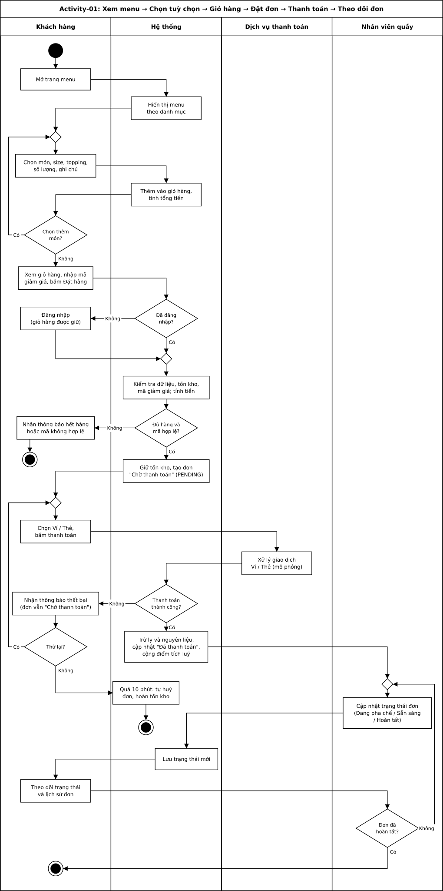
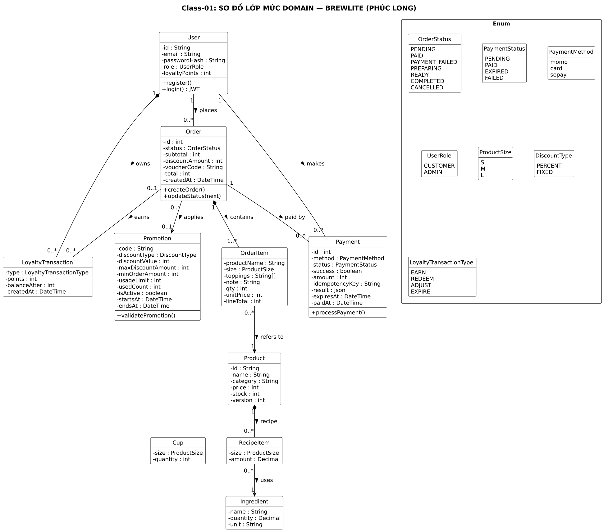

# Task 2 — Mô hình hoá hệ thống

Tên file theo chuẩn `TaskX_Y_TênSơĐồ`; mỗi sơ đồ có **file nguồn** và hai ảnh kết xuất cùng tên: **`.svg`** (xem trên GitHub, phóng to không vỡ) và **`.png`** (chèn vào báo cáo). File nguồn của activity là **`.drawio`** (mở và sửa bằng [diagrams.net](https://app.diagrams.net) hoặc extension Draw.io trong VS Code); các sơ đồ còn lại dùng **PlantUML (`.puml`)**. Mã sơ đồ (Activity-01, Sequence-01, Class-01) được dùng trong [`../traceability-matrix.md`](../traceability-matrix.md).

| Mã | Sơ đồ | Nguồn | Ảnh |
| --- | --- | --- | --- |
| Activity-01 | Luồng end-to-end Xem menu → Chọn tuỳ chọn → Giỏ hàng → Đặt đơn → Thanh toán → Theo dõi đơn | [`Task2_1_Activity.drawio`](Task2_1_Activity.drawio) | [`Task2_1_Activity.svg`](Task2_1_Activity.svg) |
| Activity-01b | Thanh toán SePay (luồng thay thế A2 của UC-01b) | [`Task2_1_Activity_SePay.drawio`](Task2_1_Activity_SePay.drawio) | [`Task2_1_Activity_SePay.svg`](Task2_1_Activity_SePay.svg) |
| Sequence-01 | UC-01 Đặt và thanh toán đơn hàng | [`Task2_2_Sequence.puml`](Task2_2_Sequence.puml) | [`Task2_2_Sequence.svg`](Task2_2_Sequence.svg) |
| Class-01 | Sơ đồ lớp mức domain | [`Task2_3_Class.puml`](Task2_3_Class.puml) | [`Task2_3_Class.svg`](Task2_3_Class.svg) |

Sơ đồ use-case của Task 1 (`Task1_2_UseCase`, `Task1_3_UseCase`) cũng nằm trong thư mục này. Mỗi file nguồn tự chứa phần định dạng, không phụ thuộc file khác.

## Task 2.1 — Activity-01



| Yêu cầu của đề | Thể hiện trong sơ đồ |
| --- | --- |
| Điểm bắt đầu và kết thúc | Một nút bắt đầu; ba nút kết thúc: đơn hoàn tất, hết hàng / mã không hợp lệ, đơn bị tự huỷ |
| Hành động của người dùng và hệ thống | Làn Khách hàng và làn Hệ thống xen kẽ theo từng bước |
| Decision/merge cho nhánh thành công và thất bại | Hình thoi có câu hỏi bên trong và nhánh Có/Không: "Chọn thêm món?", "Đã đăng nhập?", "Đủ hàng và mã hợp lệ?", "Thanh toán thành công?", "Thử lại?", "Đơn đã hoàn tất?"; hình thoi nhỏ để trống là nút merge gộp nhánh |
| Swimlane | 4 làn: Khách hàng, Hệ thống, Dịch vụ thanh toán, Nhân viên quầy |
| Chưa đăng nhập | "Đã đăng nhập?" → Không: khách đăng nhập (giỏ hàng được giữ) rồi gộp lại luồng chính |
| Hết hàng | "Đủ hàng và mã hợp lệ?" → Không: khách nhận thông báo, không tạo đơn, kết thúc |
| Thanh toán thất bại | "Thanh toán thành công?" → Không: đơn giữ `PENDING`; "Thử lại?" → Có quay lại bước thanh toán, Không thì hệ thống tự huỷ đơn sau 10 phút và hoàn tồn kho |

## Task 2.2 — Sequence-01


| Yêu cầu của đề | Thể hiện trong sơ đồ |
| --- | --- |
| Lifeline Customer → Next.js UI → NestJS API → Database → Payment Service | Đủ 5 lifeline theo đúng thứ tự |
| Request/response và thứ tự gọi API | `POST /orders` (201) rồi `POST /payments` (201); mỗi lời gọi có mũi tên trả về |
| Kiểm tra JWT và validate dữ liệu | `verifyJWT` ở cả hai request; `validate (items)`; khung `break` cho 401 (E1) và 400/404 (E2, E3) |
| Transaction khi tạo đơn và cập nhật tồn kho | Khung "Transaction tạo đơn + cập nhật tồn kho": `reserveStock` theo optimistic lock, `ROLLBACK` khi hết hàng (E4) |
| `alt` thanh toán thành công/thất bại | Khung "Transaction thanh toán" có `alt` thành công (PAID, cộng điểm, ghi Payment) và thất bại (ROLLBACK, đơn giữ PENDING) |
| Idempotency khi client gửi lại yêu cầu | `findPayment (UID, Idempotency-Key)`; gửi lại cùng key trả kết quả cũ (A1), cùng key khác nội dung trả 400 (E4) |
| Thông báo kết quả cuối cho người dùng | `alt` cuối: "Đặt hàng thành công" hoặc thông báo thất bại kèm nút thử lại |

Mã A/E trong sơ đồ là mã luồng thay thế/ngoại lệ của UC-01 trong [`../requirements/13_usecase.md`](../requirements/13_usecase.md). Dịch vụ Ví/Thẻ mô phỏng luôn chấp nhận giao dịch, nên trong thực tế thanh toán thất bại đến từ việc thiếu ly/nguyên liệu hoặc lỗi database.

## Task 2.3 — Class-01



Đủ các lớp đề yêu cầu: `User`, `Product`, `Order`, `OrderItem`, `Payment`, `Promotion`, `LoyaltyTransaction`. Mỗi lớp có thuộc tính chính; quan hệ có tên và multiplicity; enum trạng thái `OrderStatus`, `PaymentStatus` cùng các enum `PaymentMethod`, `UserRole`, `ProductSize`, `DiscountType`, `LoyaltyTransactionType`.

Mô hình khớp với `apps/api/prisma/schema.prisma`. Các bảng phụ trợ cho tồn kho (`Ingredient`, `RecipeItem`, `Cup`) không vẽ vì không thuộc phạm vi tối thiểu của đề.

## Kết xuất lại ảnh

- Sơ đồ PlantUML (`.puml`):
  ```bash
  java -jar plantuml.jar -tsvg docs/diagrams/*.puml
  java -jar plantuml.jar -tpng docs/diagrams/*.puml
  ```
- Sơ đồ draw.io (`.drawio`): mở file trong diagrams.net → *File → Export as* → SVG / PNG, lưu đè đúng tên.
