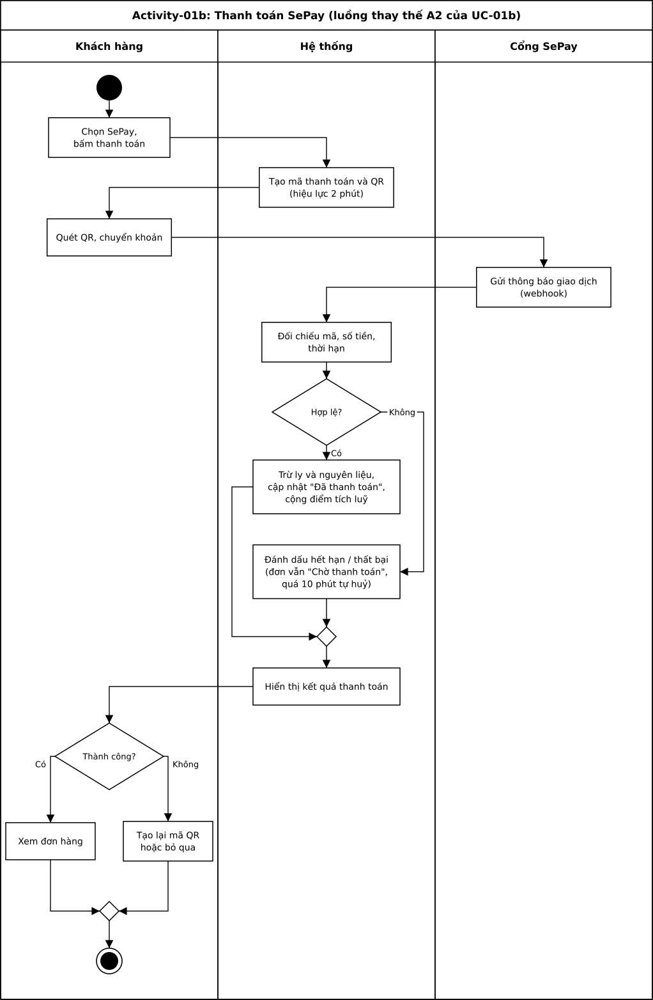
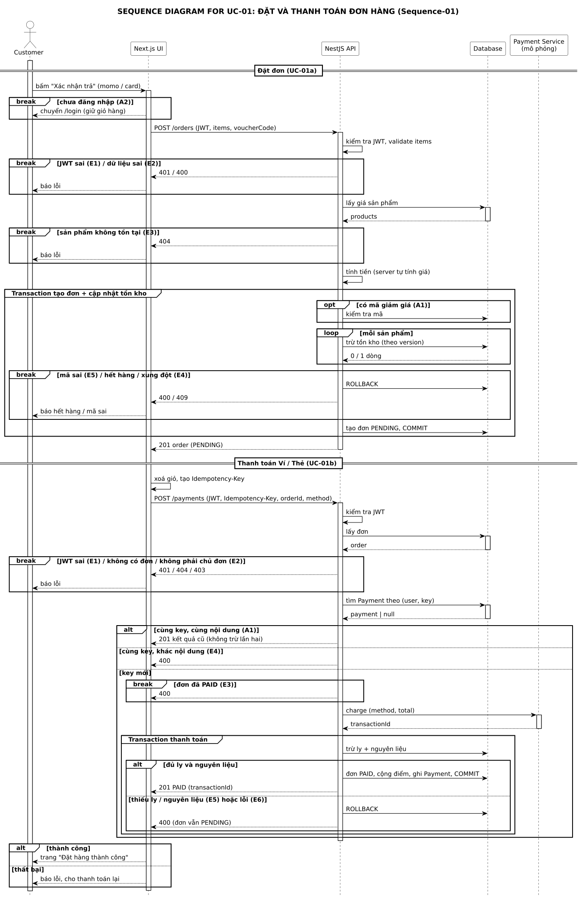

# Task 2 — Mô hình hoá hệ thống

Tên file theo chuẩn `TaskX_Y_TênSơĐồ`; mỗi sơ đồ có **file nguồn** và hai ảnh kết xuất cùng tên: **`.svg`** (xem trên GitHub, phóng to không vỡ) và **`.png`** (chèn vào báo cáo). File nguồn của activity là **`.drawio`** (mở và sửa bằng [diagrams.net](https://app.diagrams.net) hoặc extension Draw.io trong VS Code); các sơ đồ còn lại dùng **PlantUML (`.puml`)**. Mã sơ đồ (Activity-01, Sequence-01, Class-01) được dùng trong [`../traceability-matrix.md`](../traceability-matrix.md).

| Mã | Sơ đồ | Nguồn | Ảnh |
| --- | --- | --- | --- |
| Activity-01 | Luồng end-to-end Xem menu → Chọn tuỳ chọn → Giỏ hàng → Đặt đơn → Thanh toán → Theo dõi đơn | [`Task2_1_Activity.drawio`](Task2_1_Activity.drawio) | [`Task2_1_Activity.svg`](Task2_1_Activity.svg) |
| Activity-01b | Thanh toán chuyển khoản QR SePay (luồng thay thế A2 của UC-01b) | [`Task2_1_Activity_SePay.drawio`](Task2_1_Activity_SePay.drawio) | [`Task2_1_Activity_SePay.svg`](Task2_1_Activity_SePay.svg) |
| Sequence-01 | UC-01 Đặt và thanh toán đơn hàng | [`Task2_2_Sequence.puml`](Task2_2_Sequence.puml) | [`Task2_2_Sequence.svg`](Task2_2_Sequence.svg) |
| Class-01 | Sơ đồ lớp mức domain | [`Task2_3_Class.puml`](Task2_3_Class.puml) | [`Task2_3_Class.svg`](Task2_3_Class.svg) |

Sơ đồ use-case của Task 1 (`Task1_2_UseCase`, `Task1_3_UseCase`) cũng nằm trong thư mục này. Mỗi file nguồn tự chứa phần định dạng, không phụ thuộc file khác.

## Task 2.1 — Activity-01


| Yêu cầu của đề | Thể hiện trong sơ đồ |
| --- | --- |
| Điểm bắt đầu và kết thúc | Một nút bắt đầu; ba nút kết thúc: đơn hoàn tất, đặt đơn bị từ chối (hết hàng / mã sai / dữ liệu sai), đơn bị tự huỷ |
| Hành động của người dùng và hệ thống | Làn Khách hàng và làn Hệ thống xen kẽ theo từng bước; mỗi bước hệ thống ghi rõ API được gọi (`GET /products`, `POST /orders`, `POST /payments`, `PATCH /orders/:id/status`) |
| Decision/merge cho nhánh thành công và thất bại | Hình thoi có câu hỏi: "Chọn thêm món?", "Đã đăng nhập (có JWT)?", "Hợp lệ và đủ hàng?", "Phương thức?", "Đủ ly và nguyên liệu?", "Thử lại?", "Đơn đã hoàn tất?"; hình thoi nhỏ để trống là nút merge gộp nhánh |
| Swimlane | 4 làn: Khách hàng, Hệ thống, Dịch vụ thanh toán, Nhân viên quầy (ADMIN) |
| Chưa đăng nhập | "Đã đăng nhập (có JWT)?" → Không: chuyển `/login?next=/checkout` (giỏ hàng được giữ); đăng nhập xong quay lại Checkout và bấm "Xác nhận trả" lần nữa |
| Hết hàng | "Hợp lệ và đủ hàng?" → Không: `POST /orders` trả 400 / 409, khách nhận thông báo, không tạo đơn, giỏ hàng giữ nguyên |
| Thanh toán thất bại | Ví / Thẻ: "Đủ ly và nguyên liệu?" → Không: rollback, đơn giữ `PENDING`; "Thử lại?" → Có: mở `/orders/[id]` và thanh toán bằng SePay (Activity-01b), Không: bộ hẹn giờ tự huỷ đơn sau 10 phút và hoàn tồn kho. Nhánh SePay là bước gọi sang Activity-01b (đi tiếp khi đơn PAID; hết hạn và tự huỷ được vẽ trong Activity-01b) |

## Activity-01b — Thanh toán SePay



4 làn: Khách hàng, Web (Next.js), API (NestJS), Cổng SePay. Sau khi mở phiên QR (`POST /payments/sepay/checkout`, hạn 2 phút), luồng tách đôi bằng thanh fork: một nhánh khách chuyển khoản → SePay gọi webhook → API đối soát và hoàn tất đơn trong một transaction; nhánh kia là trang `/payments/sepay/[id]` hỏi `GET /orders/:id` mỗi 3 giây. Hết giờ thì phiên `EXPIRED`, đơn `PAYMENT_FAILED`, khách có thể "Thanh toán lại" (`restart = true`); bỏ dở thì bộ hẹn giờ huỷ đơn sau 10 phút và hoàn tồn kho.

## Task 2.2 — Sequence-01



| Yêu cầu của đề | Thể hiện trong sơ đồ |
| --- | --- |
| Lifeline Customer → Next.js UI → NestJS API → Database → Payment Service | Đủ 5 lifeline theo đúng thứ tự |
| Request/response và thứ tự gọi API | `POST /orders` (201) rồi `POST /payments` (201); mỗi lời gọi có mũi tên trả về |
| Kiểm tra JWT và validate dữ liệu | "kiểm tra JWT, validate items"; khung `break` cho 401 (E1), 400 (E2), 404 (E3), 403 (không phải chủ đơn) |
| Transaction khi tạo đơn và cập nhật tồn kho | Khung "Transaction tạo đơn + cập nhật tồn kho": kiểm tra mã, trừ tồn kho theo `version` (optimistic lock), tạo đơn PENDING; `ROLLBACK` khi mã sai, hết hàng (400) hoặc xung đột (409) |
| `alt` thanh toán thành công/thất bại | Khung "Transaction thanh toán": trừ ly + nguyên liệu, rồi `alt` thành công (PAID, cộng điểm, ghi Payment, COMMIT) / thất bại (ROLLBACK, đơn giữ PENDING, không ghi Payment) |
| Idempotency khi client gửi lại yêu cầu | "tìm Payment theo (user, key)" chạy **trước** kiểm tra "đơn đã PAID" (giống `payments.service.ts`): cùng key cùng nội dung trả kết quả cũ (A1), cùng key khác nội dung trả 400 (E4) |
| Thông báo kết quả cuối cho người dùng | `alt` cuối: trang "Đặt hàng thành công" hoặc báo lỗi, cho thanh toán lại |

Mã A/E trong sơ đồ là mã luồng thay thế/ngoại lệ của UC-01 trong [`../requirements/13_usecase.md`](../requirements/13_usecase.md). Dịch vụ Ví/Thẻ mô phỏng chạy ngay trong `PaymentsService` (sinh `transactionId`, luôn chấp nhận), nên trong thực tế thanh toán thất bại đến từ việc thiếu ly/nguyên liệu hoặc lỗi database.

## Task 2.3 — Class-01


Đủ các lớp đề yêu cầu: `User`, `Product`, `Order`, `OrderItem`, `Payment`, `Promotion`, `LoyaltyTransaction`, thêm ba bảng tồn kho mà luồng thanh toán trừ trực tiếp: `Ingredient`, `RecipeItem`, `Cup`. Mỗi lớp có thuộc tính chính theo schema; quan hệ có tên và multiplicity; các enum (`OrderStatus`, `PaymentStatus`, `PaymentMethod`, `UserRole`, `ProductSize`, `DiscountType`, `LoyaltyTransactionType`) gom trong khung Enum và được dùng làm kiểu thuộc tính.

Mô hình khớp với `apps/api/prisma/schema.prisma`. `Payment.method` / `Payment.status` là cột TEXT (giá trị `momo` / `card` / `sepay` và `PENDING` / `PAID` / `EXPIRED` / `FAILED` theo `payments.data.ts`), `transactionId` nằm trong cột `result` (Json).

## Kết xuất lại ảnh

- Sơ đồ PlantUML (`.puml`):
  ```bash
  java -DPLANTUML_LIMIT_SIZE=16384 -jar plantuml.jar -tsvg docs/diagrams/*.puml
  java -DPLANTUML_LIMIT_SIZE=16384 -jar plantuml.jar -tpng docs/diagrams/*.puml
  ```
- Sơ đồ draw.io (`.drawio`): mở file trong diagrams.net → *File → Export as* → SVG / PNG, lưu đè đúng tên.
