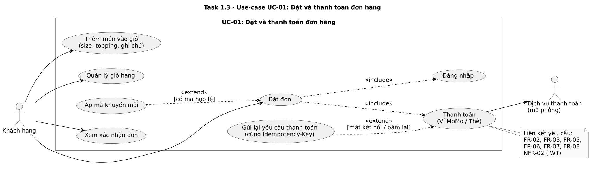

# Task 1.3 — Đặc tả use-case trọng tâm

**UC-01: Đặt và thanh toán đơn hàng** (theo khuyến nghị Task 1.3 của đề bài). UC-01 gồm hai phần nối tiếp: **Đặt đơn hàng** (UC06 trong sơ đồ tổng quát) và **Thanh toán đơn hàng** (UC07).

## Sơ đồ use-case phạm vi UC-01

Nguồn: [`docs/diagrams/Task1_3_UseCase.puml`](../diagrams/Task1_3_UseCase.puml) (ảnh `.svg`/`.png` cùng thư mục; bản vẽ tay ban đầu: `13_usecase.png`). Sơ đồ toàn hệ thống: [`Task1_2_UseCase.svg`](../diagrams/Task1_2_UseCase.svg) (Task 1.2).

## 1. Đặt đơn hàng

| | |
| :---: | :--- |
| **Mã** | UC-01a (UC06) |
| **Tóm tắt** | Khách hàng chuyển các món đã chọn trong giỏ hàng thành một đơn hàng. |
| **Actor chính** | Khách hàng (đã đăng nhập) |
| **Trigger** | Khách hàng bấm **“Đặt hàng / Xác nhận trả”** ở trang Checkout. |
| **Tiền điều kiện** | Giỏ hàng có ít nhất một món; khách hàng có JWT hợp lệ (nếu chưa có sẽ được chuyển sang đăng nhập — luồng thay thế A2). |
| **Hậu điều kiện (thành công)** | Đơn hàng được lưu trong PostgreSQL ở trạng thái **PENDING** kèm danh sách OrderItem; giá do server tính; tồn kho sản phẩm được giữ chỗ. |
| **Hậu điều kiện (thất bại)** | Không có đơn mới; giỏ hàng trên trình duyệt giữ nguyên để khách thử lại. |

**Luồng chính**

1. Khách hàng xem menu, chọn món kèm size, topping, ghi chú, số lượng và thêm vào giỏ hàng.
2. Khách hàng mở trang Checkout và kiểm tra lại giỏ hàng, tổng tiền.
3. Khách hàng (tuỳ chọn) nhập mã khuyến mãi và chọn phương thức thanh toán.
4. Khách hàng bấm “Đặt hàng”.
5. Next.js gửi `POST /orders` kèm JWT và danh sách món (không gửi giá).
6. API kiểm tra JWT, validate dữ liệu, tra bảng giá, tính `unitPrice`/`lineTotal`, áp mã khuyến mãi (nếu có) và kiểm tra tồn kho sản phẩm.
7. API tạo Order (PENDING) + OrderItem trong một transaction, trả về mã đơn.
8. Hệ thống chuyển sang bước thanh toán (mục 2).

**Luồng thay thế**

| Mã | Tại bước | Điều kiện | Xử lý |
| --- | --- | --- | --- |
| A1 | 3 | Khách nhập mã khuyến mãi hợp lệ | Hệ thống gọi `POST /promotions/validate`, hiển thị số tiền giảm; đơn được tạo với `subtotal`, `discountAmount`, `total` sau giảm. |
| A2 | 4 | Khách chưa đăng nhập | Web chuyển sang `/login?next=/checkout`; sau khi đăng nhập quay lại Checkout, giỏ hàng giữ nguyên, tiếp tục từ bước 4. |
| A3 | 2 | Giỏ hàng trống | Nút đặt hàng bị vô hiệu, hệ thống gợi ý quay lại menu chọn món. |

**Luồng ngoại lệ**

| Mã | Tại bước | Tình huống | Phản hồi của hệ thống |
| --- | --- | --- | --- |
| E1 | 6 | JWT thiếu, sai hoặc hết hạn | `401 Unauthorized`; web xoá token và chuyển sang trang đăng nhập. |
| E2 | 6 | Dữ liệu không hợp lệ (giỏ rỗng, `qty < 1`, size sai) | `400 Bad Request` kèm thông báo; không tạo đơn. |
| E3 | 6 | Sản phẩm không tồn tại | `404 Not Found`. |
| E4 | 6 | Sản phẩm hết hàng / không đủ tồn kho | `400` “không đủ số lượng tồn kho”; hai người cùng đặt món cuối cùng → một người nhận `409 Conflict` (optimistic lock). |
| E5 | 3 | Mã khuyến mãi không tồn tại, hết hạn hoặc chưa đủ giá trị tối thiểu | `400` kèm lý do; khách bỏ mã hoặc nhập mã khác. |
| E6 | 5 | Mất kết nối / API không phản hồi | Web hiển thị lỗi và nút thử lại; giỏ hàng không bị mất. |

## 2. Thanh toán đơn hàng

| | |
| :---: | :--- |
| **Mã** | UC-01b (UC07) |
| **Tóm tắt** | Khách hàng thanh toán đơn bằng Ví MoMo hoặc Thẻ (dịch vụ mô phỏng). |
| **Actor** | Khách hàng (chính); Dịch vụ thanh toán mô phỏng (phụ) |
| **Trigger** | Đơn vừa được tạo ở trạng thái PENDING và khách bấm **“Thanh toán”** (hoặc web tự gửi ngay sau bước tạo đơn). |
| **Tiền điều kiện** | Đơn tồn tại, thuộc khách hàng đang đăng nhập và đang ở trạng thái PENDING; client sinh một `Idempotency-Key` cho lần thanh toán. |
| **Hậu điều kiện (thành công)** | Đơn chuyển **PAID**; nguyên liệu (theo công thức) và ly (theo size) được trừ; bản ghi Payment có `transactionId`; khách được cộng điểm thưởng — tất cả trong **một transaction**. |
| **Hậu điều kiện (thất bại)** | Transaction rollback: không trừ kho, không có Payment thành công, đơn vẫn PENDING để thử lại; đơn PENDING quá hạn (mặc định 10 phút) bị hủy tự động và hoàn kho. |

**Luồng chính**

1. Khách hàng chọn phương thức (MoMo hoặc Thẻ).
2. Khách hàng bấm “Thanh toán”.
3. Web gửi `POST /payments` với JWT, header `Idempotency-Key` và `{ orderId, method }`.
4. API kiểm tra JWT, quyền sở hữu đơn và trạng thái PENDING.
5. API gọi dịch vụ thanh toán mô phỏng, nhận kết quả thành công.
6. Trong một transaction: trừ ly và nguyên liệu, cập nhật đơn PAID, ghi Payment, cộng điểm thưởng.
7. API trả `201` kèm `transactionId`.
8. Web chuyển đến trang “Đặt hàng thành công” và trang xác nhận `/orders/[id]` hiển thị “Đã thanh toán”.

**Luồng thay thế**

| Mã | Tại bước | Điều kiện | Xử lý |
| --- | --- | --- | --- |
| A1 | 3 | Client gửi lại yêu cầu với **cùng Idempotency-Key** (mất mạng, bấm hai lần) | API trả lại đúng kết quả lần đầu (cùng `transactionId`), không trừ tiền/kho lần hai. |
| A2 | 1 | Khách chọn chuyển khoản QR SePay (FR-10) | `POST /payments/sepay/checkout` tạo mã QR hiệu lực 2 phút; đơn chuyển PAID khi webhook SePay xác nhận đã nhận đủ tiền; quá hạn hoặc thiếu tiền thì đơn giữ PENDING và khách có thể tạo lại mã QR (sơ đồ `Task2_1_Activity_SePay`). |

**Luồng ngoại lệ**

| Mã | Tại bước | Tình huống | Phản hồi của hệ thống |
| --- | --- | --- | --- |
| E1 | 4 | Không có JWT / JWT hết hạn | `401`; chuyển sang đăng nhập. |
| E2 | 4 | Đơn thuộc người khác | `403 Forbidden`. |
| E3 | 4 | Đơn đã PAID, thanh toán lại với khóa mới | `400` “Đơn hàng này đã được thanh toán trước đó”. |
| E4 | 3 | Cùng Idempotency-Key nhưng nội dung khác (VD đổi phương thức) | `400` “Idempotency-Key đã được dùng cho một yêu cầu khác”. |
| E5 | 6 | Hết ly hoặc không đủ nguyên liệu | `400` kèm tên nguyên liệu/size; transaction rollback, không trừ kho. |
| E6 | 5–6 | Dịch vụ thanh toán / database lỗi | Transaction rollback, API trả lỗi, web báo thử lại; `GET /health` trả `503` khi database mất kết nối. |

## 3. Liên kết yêu cầu và tiêu chí chấp nhận

| Use-case | Mã yêu cầu liên quan | Tiêu chí chấp nhận (đầu vào viết test) |
| --- | --- | --- |
| Đặt đơn hàng | FR-02, FR-03, FR-05, FR-08 · NFR-02 | AC-01: `POST /orders` không JWT → 401 (`jwt-auth.guard.spec.ts`, INT-T04) · AC-05: dữ liệu sai → 400, giá do server tính (INT-T04) · AC-06: đơn không tồn tại → 404 (`orders.service.spec.ts`) |
| Thanh toán đơn hàng | FR-06, FR-07, FR-10, FR-11 · NFR-02, NFR-05 | AC-02: retry cùng idempotency-key không trừ trùng (`payments.service.spec.ts`, INT-T06) · AC-03: thành công → PAID + trừ kho (`payments.service.spec.ts`, INT-T05) · AC-04: thất bại → không trừ kho (`payments.service.spec.ts`) · AC-07: DB down → 503 (`health.controller.spec.ts`) · AC-08: đơn người khác → 403 (INT-T07) |

Sơ đồ liên quan: [`Task1_3_UseCase.svg`](../diagrams/Task1_3_UseCase.svg) (use-case UC-01) · [`Task1_2_UseCase.svg`](../diagrams/Task1_2_UseCase.svg) (use-case tổng quát) · [Activity-01 `Task2_1_Activity.svg`](../diagrams/Task2_1_Activity.svg) (activity end-to-end) · [Sequence-01 `Task2_2_Sequence.svg`](../diagrams/Task2_2_Sequence.svg) (sequence UC-01, dùng các mã A/E ở trên) · [Class-01 `Task2_3_Class.svg`](../diagrams/Task2_3_Class.svg) (class domain).
