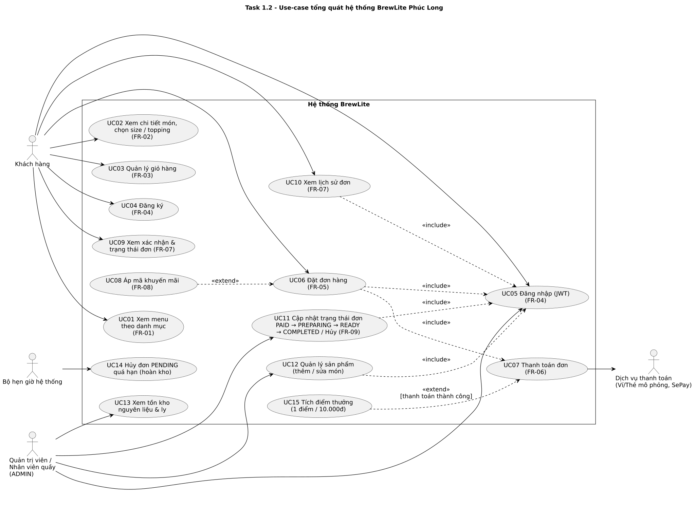

# Task 1 - 1.2

## 1. Yêu cầu chức năng (Functional Requirements - FR)

| Mã FR | Tên yêu cầu | Mô tả chi tiết | Mức ưu tiên | Tiêu chí chấp nhận |
| :--- | :--- | :--- | :--- | :--- |
| **FR-01** | Xem menu | Hiển thị danh sách sản phẩm, danh sách đồ uống kèm giá và sản phẩm | Must | API trả về mã 200, danh sách hiển thị đúng danh mục, có skeleton loading khi tải trang. |
| **FR-02** | Xem chi tiết sản phẩm | Hiển thị chi tiết món, cho phép chọn size (S/M/L) và topping đi kèm | Must | Giá tổng thay đổi linh hoạt theo size/topping được chọn. |
| **FR-03** | Quản lý giỏ hàng | Thêm, sửa số lượng, xóa món trong giỏ hàng và tính tổng tiền. | Must | Dữ liệu giỏ hàng lưu local/state đồng bộ, cập nhật tổng thanh toán chính xác. |
| **FR-04** | Đăng ký & Đăng nhập | Xác thực tài khoản khách hàng thông qua chuẩn JWT. | Must | Đăng nhập thành công trả về JWT token hợp lệ, lưu trữ an toàn phía client. |
| **FR-05** | Tạo đơn hàng | Chuyển đổi giỏ hàng thành đơn hàng ở trạng thái PENDING. | Must | Ghi nhận đơn hàng vào PostgreSQL kèm danh sách OrderItem và số tiền. |
| **FR-06** | Thanh toán đơn hàng | Gọi dịch vụ Mock Payment để thanh toán đơn hàng bằng Thẻ/Ví | Must | Xử lý Idempotency Key, cập nhật trạng thái đơn thành PAID nếu thành công, FAILED nếu thất bại. |
| **FR-07** | Xem lịch sử & trạng thái | Khách hàng theo dõi trạng thái đơn hàng của mình theo thời gian thực | Should | Hiển thị đúng trạng thái đơn hàng: Chờ xác nhận, Đang pha chế, Hoàn thành. |
| **FR-08** | Áp dụng khuyến mãi | Nhập mã giảm giá để trừ tiền vào đơn. | Could | Giảm đúng số tiền/tỷ lệ phần trăm và cập nhật lại tổng tiền trước khi thanh toán. |
| **FR-09** | Quản lý trạng thái đơn | Quản trị viên/nhân viên quầy (ADMIN) chuyển trạng thái đơn theo máy trạng thái PENDING → PAID → PREPARING → READY → COMPLETED; đơn PENDING/PAID có thể hủy (CANCELLED) và hoàn tồn kho; đơn PENDING quá hạn tự hủy. | Must | `PATCH /orders/:id/status` chỉ cho chủ đơn hoặc ADMIN (403 nếu khác); chuyển sai bước (VD: PAID → PENDING, COMPLETED → bất kỳ) trả 400; hủy đơn hoàn lại nguyên liệu/ly; khách thấy trạng thái mới ở `/orders/[id]`. |

---

## 2. Yêu cầu phi chức năng (Non-Functional Requirements - NFR)

| Mã NFR | Nhóm yêu cầu | Nội dung yêu cầu | Mức ưu tiên | Tiêu chí chấp nhận |
| :--- | :--- | :--- | :--- | :--- |
| **NFR-01** | Hiệu năng | Thời gian phản hồi API menu và sản phẩm. | Should | Phản hồi dưới 500ms với 95% số request. |
| **NFR-02** | Bảo mật | Bảo vệ các API tạo đơn, thanh toán bằng JWT. | Must | Không có JWT hợp lệ trả về HTTP 401 Unauthorized. |
| **NFR-03** | Khả dụng (dễ dùng trên di động) | Thiết kế giao diện Mobile-first/PWA. | Must | Bố cục hiển thị chuẩn trên màn hình từ 360px trở lên; có web app manifest (`/manifest.webmanifest`) và icon để cài lên màn hình chính. |
| **NFR-04** | Triển khai | Đóng gói và chạy qua Docker container. | Must | Lệnh `docker-compose up` khởi chạy thành công; `GET /health` trả về HTTP 200. |
| **NFR-05** | Tính sẵn sàng | Hệ thống production truy cập được qua HTTPS; tự phát hiện lỗi sau triển khai và quay về bản ổn định. | Must | `GET /health` trả 200 và `database: up` sau mỗi lần deploy (smoke test trong CD); deploy lỗi thì pipeline dừng và rollback; database production không mở public. |
| **NFR-06** | Bảo mật cấu hình & nhật ký | Secret chỉ nằm trong biến môi trường của nền tảng/CI; ghi log khởi động, lỗi và request để chẩn đoán sự cố. | Must | Không có secret thật trong repository hoặc log CI (`.env` bị `.gitignore`, secret dùng `secrets.*` của GitHub Actions); log API xem được trên Render. |

---

## 3. Sơ đồ use-case tổng quát

Nguồn: [`docs/diagrams/Task1_2_UseCase.puml`](../diagrams/Task1_2_UseCase.puml) · ảnh: `Task1_2_UseCase.svg`, `Task1_2_UseCase.png`.

| Actor | Use-case chính |
| --- | --- |
| Khách hàng | UC01 Xem menu · UC02 Chi tiết món · UC03 Giỏ hàng · UC04 Đăng ký · UC05 Đăng nhập · UC06 Đặt đơn · UC09 Xác nhận & trạng thái · UC10 Lịch sử đơn |
| Quản trị viên / Nhân viên quầy (ADMIN) | UC11 Cập nhật trạng thái đơn · UC12 Quản lý sản phẩm · UC13 Xem tồn kho |
| Dịch vụ thanh toán (mô phỏng / SePay) | UC07 Thanh toán đơn |
| Bộ hẹn giờ hệ thống | UC14 Hủy đơn PENDING quá hạn |

Use-case trọng tâm được đặc tả chi tiết: **UC-01 Đặt và thanh toán đơn hàng** (gồm UC06 + UC07) — xem [`13_usecase.md`](13_usecase.md).
